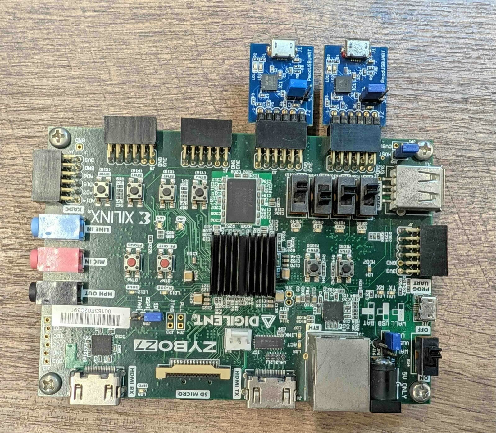

# Overview

Here we provide a script that generates the bitstream used by the following repository.

https://github.com/hkato-sssl/zynq7000-baremetal-rs

# Environment

- **Board**
  - [Zybo Z7-20](https://digilent.com/shop/zybo-z7-zynq-7000-arm-fpga-soc-development-board/)
- **Parts**
  - [Pmod USBUART](https://digilent.com/reference/pmod/pmodusbuart/start) x2
- **Tools**
  - Vivado 2025.1
  - Vitis 2025.1
- **Host OS**
  - Ubuntu 24.04 Desktop

# Block Design

The Block Design used for verification is shown below.


It includes two UART Lite instances for the console and two AXI GPIO instances for LED control and Switch/Button input. The UARTs are connected to the Pmod USBUARTs, but the example also works with only the on-board UART if you do not have them.

The Pmod USBUART connections are as follows.



# Vivado Build Procedure

## Creating the Bitstream

First, generate the bitstream with Vivado. Start by fetching the set of scripts with the following commands.

```bash
cd $HOME
git clone -b pmod-usbuart-x2 https://github.com/hkato-sssl/zybo-z7-20-example.git
```

Next, run the fetched script in Vivado. The script can be run entirely from the CLI.

```bash
source /tools/Xilinx/2025.1/Vivado/settings64.sh
cd $HOME/zybo-z7-20-example
vivado -source vivado/script/zybo-z7-20-example.tcl -mode batch
```

If you remove Vivado's `-mode batch` option, it runs in the GUI.

The Vivado project is created in `$HOME/ws/vivado/zybo-z7-20-example/`.

When the script finishes successfully, `zybo-z7-20-example.xsa` is created under the project directory.

# PetaLinux Build Procedure

Using the XSA file created above, build Linux and U-Boot. Linux is not used in this article, but it is built here for verification purposes.

## Prerequisites

The procedure assumes the following conditions.

- The PetaLinux tools are available.
- `zybo-z7-20-example.xsa` has been copied to your home directory.

## Preparation

First, set the environment variables. Here, the project is created under `$HOME/petalinux/`.

```bash
WORK_DIR=$HOME/petalinux
PROJ_NAME=zybo-z7-20-example
PROJ_DIR=$WORK_DIR/$PROJ_NAME
PROJ_XSA=$HOME/$PROJ_NAME.xsa
```

## Creating the Project

Next, create the project and import the XSA file created earlier.

```bash
mkdir -p $WORK_DIR
cd $WORK_DIR
petalinux-create project --template zynq --name $PROJ_NAME
cd $PROJ_DIR
petalinux-config --get-hw-description $PROJ_XSA --silentconfig
```

## Build

After building PetaLinux and U-Boot, create BOOT.BIN.

```bash
# build images
petalinux-build
# create BOOT.BIN
petalinux-package --boot --fsbl images/linux/zynq_fsbl.elf --fpga images/linux/system.bit --u-boot --force
```

